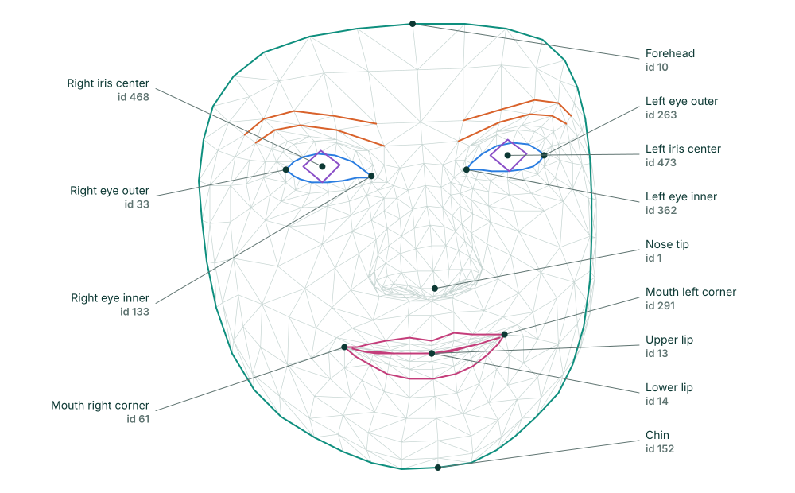

# Face Mesh Detector

Finds faces and returns 478 landmarks for each, covering the face outline, eyes, eyebrows, lips and irises.

{ .dw-demo width=360 height=344 }

## Basic use

```python
import cv2 as cv
from detectors_world import create_detector

cap = cv.VideoCapture(0)

with create_detector("face_mesh", max_faces=1) as face_mesh:
    while True:
        ok, frame = cap.read()
        if not ok:
            break

        faces = face_mesh.detect(frame)
        if faces:
            print("Nose tip:", faces[0][1])

        cv.imshow("Face Mesh", frame)
        if cv.waitKey(1) & 0xFF == ord("q"):
            break

cap.release()
cv.destroyAllWindows()
```

## Options

| Option | Default | Meaning |
|---|---|---|
| `max_faces` | `2` | Largest number of faces to look for |
| `detection_confidence` | `0.5` | Minimum confidence to report a new face |
| `tracking_confidence` | `0.5` | Minimum confidence to keep following a face between frames |
| `static_image` | `False` | Set to `True` for unrelated photos |
| `model_path` | `None` | Use your own copy of `face_landmarker.task` |

## Landmark map

This map labels the landmarks you are most likely to need, and colors each region. "Left" and "right" are the person's own sides.

{ .dw-map .dw-map--mesh }

| Id | Landmark |
|---|---|
| 1 | Nose tip |
| 10 | Top of the forehead |
| 152 | Chin |
| 33, 133 | Right eye outer and inner corners |
| 362, 263 | Left eye inner and outer corners |
| 159, 145 | Right eye upper and lower lids |
| 386, 374 | Left eye upper and lower lids |
| 468, 473 | Right and left iris centers |
| 61, 291 | Right and left mouth corners |
| 13, 14 | Upper and lower lip, inner edge |

### Landmarks by region

--8<-- "docs/.snippets/face-mesh-regions.md"

### Find any landmark

To see every number on your own face, write the ids onto the frame:

```python
faces = face_mesh.detect(frame, draw=False)
face_mesh.locate(frame, show_ids=True)
```

Make the window large, because 478 numbers fill a small image quickly.

## Results

`face_mesh.detect(frame)` returns a list of `Landmarks`, one per face:

```python
faces = face_mesh.detect(frame)

if faces:
    found = faces[0]
    found.points       # 478 (x, y) pixel positions
    found.normalized   # 478 (x, y, z) values
    found[1]           # the nose tip, as (x, y)
```

`label` and `score` are `None` for faces.

## Drawing

`detect()` draws a ring on each landmark and the outlines of the face, eyes, eyebrows and lips:

| Argument | Default | Meaning |
|---|---|---|
| `draw` | `True` | Draw the mesh |
| `color` | `(224, 224, 224)` | Color as `(blue, green, red)` |
| `thickness` | `1` | Line thickness in pixels |
| `radius` | `2` | Ring radius in pixels |

## Finding landmarks with locate()

`face_mesh.locate()` returns one face as `[[id, x, y], ...]`. Unlike the other detectors, it only draws when you ask, because 478 markers would cover the face.

```python
face_mesh.detect(frame)
landmarks = face_mesh.locate(frame, face=0)
```

| Argument | Default | Meaning |
|---|---|---|
| `face` | `0` | Which face to return, counting from 0 |
| `draw` | `False` | Draw a dot on each landmark |
| `show_ids` | `False` | Write each landmark's number on the frame |
| `color` | `(0, 255, 0)` | Dot and text color as `(blue, green, red)` |
| `radius` | `1` | Dot radius in pixels |

It returns `[]` if that face isn't visible.

## Recipes

### How open is the mouth?

Compare the gap between the lips with the width of the mouth, so that the result doesn't change with distance from the camera:

```python
import math

gap = math.dist(found[13], found[14])
width = math.dist(found[61], found[291])
mouth_open = gap / width > 0.3
```

### Is an eye closed?

```python
height = math.dist(found[159], found[145])
width = math.dist(found[33], found[133])
right_eye_closed = height / width < 0.2
```

The [Blink Counter](../examples/blink-counter.md) builds on this.

## Related

- [Blink Counter](../examples/blink-counter.md)
- [Face](face.md), if you only need face boxes
- [`FaceMesh` in the API reference](../reference/api.md#detectors_world.FaceMesh)
