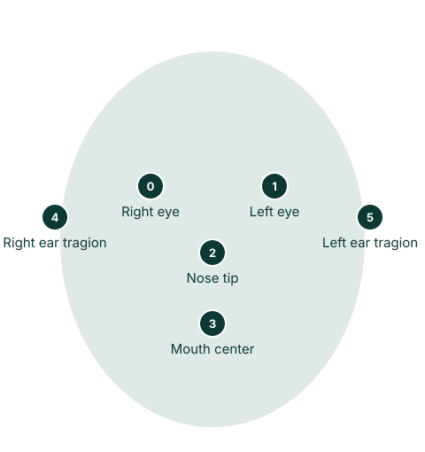

# Face Detector

Finds faces in an image and returns a box, a confidence score and 6 key points for each. It works best on faces within about 2 meters of the camera.

{ .dw-demo width=360 height=204 }

## Basic use

```python
import cv2 as cv
from detectors_world import create_detector

cap = cv.VideoCapture(0)

with create_detector("face") as face:
    while True:
        ok, frame = cap.read()
        if not ok:
            break

        faces = face.detect(frame, draw=False)
        face.locate(frame)   # draws a framed box and the score

        cv.imshow("Face Detection", frame)
        if cv.waitKey(1) & 0xFF == ord("q"):
            break

cap.release()
cv.destroyAllWindows()
```

## Options

| Option | Default | Meaning |
|---|---|---|
| `detection_confidence` | `0.6` | Minimum confidence to report a face |
| `static_image` | `False` | Set to `True` for unrelated photos |
| `model_path` | `None` | Use your own copy of `blaze_face_short_range.tflite` |

## Key point map

Each face has 6 key points. "Left" and "right" are the person's own sides.

{ .dw-map .dw-map--face }

--8<-- "docs/.snippets/face-keypoints.md"

## Results

`face.detect(frame)` returns a list of `FaceBox`, one per face:

```python
faces = face.detect(frame)

for found in faces:
    found.x, found.y            # top-left corner
    found.width, found.height   # size
    found.box                   # (x, y, width, height)
    found.score                 # confidence from 0.0 to 1.0
    found.keypoints             # 6 (x, y) pixel positions
```

By default `detect()` draws a thin box and the key points. Part of a box can fall outside the image when a face is near the edge, so limit it before slicing the image:

```python
x, y = max(found.x, 0), max(found.y, 0)
region = frame[y : found.y + found.height, x : found.x + found.width]
```

## Drawing with locate()

`face.locate()` draws a framed box with the confidence percentage, and returns `[[id, (x, y, width, height), score], ...]`:

```python
face.detect(frame, draw=False)
boxes = face.locate(frame)
```

| Argument | Default | Meaning |
|---|---|---|
| `draw` | `True` | Draw the framed box and score |
| `color` | `(0, 255, 0)` | Drawing color as `(blue, green, red)` |

It returns `[]` when no face is visible.

## Recipes

### Count people looking at the camera

```python
print(f"{len(face.detect(frame))} faces")
```

### Only report confident faces

```python
face = create_detector("face", detection_confidence=0.8)
```

### Find the closest face

The largest box is usually the closest:

```python
closest = max(faces, key=lambda found: found.width * found.height, default=None)
```

## Related

- [Face Blur](../examples/face-blur.md)
- [Face Mesh](face-mesh.md), if you need more than 6 points
- [`Face` in the API reference](../reference/api.md#detectors_world.Face)
