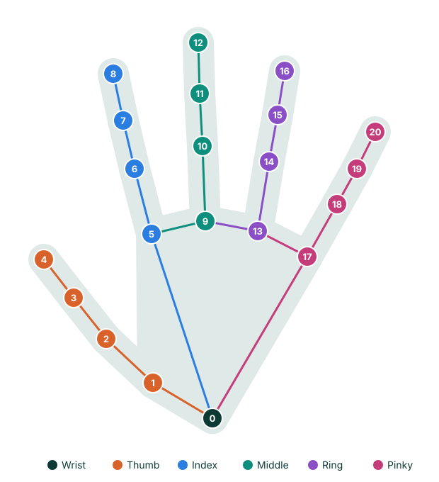

# Hand Detector

Finds hands in an image and returns 21 landmarks for each, along with whether it is a left or right hand.

{ .dw-demo width=380 height=254 }

## Basic use

```python
import cv2 as cv
from detectors_world import create_detector

cap = cv.VideoCapture(0)

with create_detector("hand", max_hands=2) as hand:
    while True:
        ok, frame = cap.read()
        if not ok:
            break

        hands = hand.detect(frame)
        for found in hands:
            print(found.label, found[8])

        cv.imshow("Hand Detection", frame)
        if cv.waitKey(1) & 0xFF == ord("q"):
            break

cap.release()
cv.destroyAllWindows()
```

## Options

| Option | Default | Meaning |
|---|---|---|
| `max_hands` | `2` | Largest number of hands to look for |
| `detection_confidence` | `0.5` | Minimum confidence to report a new hand |
| `tracking_confidence` | `0.5` | Minimum confidence to keep following a hand between frames |
| `static_image` | `False` | Set to `True` for unrelated photos |
| `model_path` | `None` | Use your own copy of `hand_landmarker.task` |

## Landmark map

Each hand has 21 landmarks, numbered from the wrist out to each fingertip. The numbers are the same for left and right hands.

{ .dw-map .dw-map--hand }

--8<-- "docs/.snippets/hand-landmarks.md"

Fingertips are 4, 8, 12, 16 and 20.

## Results

`hand.detect(frame)` returns a list of `Landmarks`, one per hand:

```python
hands = hand.detect(frame)

for found in hands:
    found.label        # "Left" or "Right"
    found.score        # confidence of the label
    found.points       # 21 (x, y) pixel positions
    found.normalized   # 21 (x, y, z) values
    found[4]           # the thumb tip, as (x, y)
```

### Left and right

Labels name the person's own hands in a normal camera image. A mirrored frame, such as one from `cv.flip(frame, 1)`, swaps them, so a person's left hand is reported as `"Right"`.

If you flip frames for a mirror-like view, either run `detect()` before flipping, or swap the labels yourself.

## Finding landmarks with locate()

`hand.locate()` returns one hand as `[[id, x, y], ...]`, and draws a dot on each landmark:

```python
hand.detect(frame)
landmarks = hand.locate(frame, hand=0)

if landmarks:
    id_number, x, y = landmarks[8]
```

| Argument | Default | Meaning |
|---|---|---|
| `hand` | `0` | Which hand to return, counting from 0 |
| `draw` | `True` | Draw a dot on each landmark |
| `color` | `(0, 255, 0)` | Dot color as `(blue, green, red)` |
| `radius` | `6` | Dot radius in pixels |

It returns `[]` if that hand isn't visible.

## Recipes

### Is a finger raised?

With the hand upright, a fingertip above its middle joint has a smaller `y`:

```python
index_raised = found[8][1] < found[6][1]
```

The [Finger Counter](../examples/finger-counter.md) extends this to the whole hand.

### Distance between two landmarks

```python
import math

pinch = math.dist(found[4], found[8])
```

The [Pinch Distance](../examples/pinch-distance.md) example turns this into a control.

### Follow one hand only

```python
hand = create_detector("hand", max_hands=1)
```

Looking for fewer hands is also a little faster.

## Related

- [Finger Counter](../examples/finger-counter.md)
- [Pinch Distance](../examples/pinch-distance.md)
- [`Hand` in the API reference](../reference/api.md#detectors_world.Hand)
