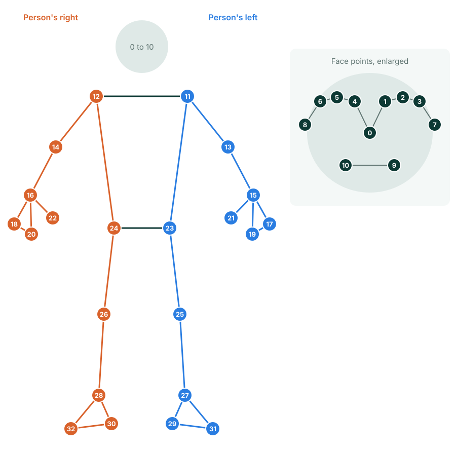

# Pose Detector

Finds a person's body and returns 33 landmarks, from the face down to the feet.

{ .dw-demo width=360 height=254 }

## Basic use

```python
import cv2 as cv
from detectors_world import create_detector

cap = cv.VideoCapture(0)

with create_detector("pose") as pose:
    while True:
        ok, frame = cap.read()
        if not ok:
            break

        bodies = pose.detect(frame)
        if bodies:
            print("Left shoulder:", bodies[0][11])

        cv.imshow("Pose Detection", frame)
        if cv.waitKey(1) & 0xFF == ord("q"):
            break

cap.release()
cv.destroyAllWindows()
```

## Options

| Option | Default | Meaning |
|---|---|---|
| `model` | `"full"` | Which model to use, see below |
| `max_poses` | `1` | Largest number of people to look for |
| `detection_confidence` | `0.5` | Minimum confidence to report a new body |
| `tracking_confidence` | `0.5` | Minimum confidence to keep following a body between frames |
| `static_image` | `False` | Set to `True` for unrelated photos |
| `model_path` | `None` | Use your own copy of the model file |

### Choosing a model

| Model | Download | Use it when |
|---|---|---|
| `"lite"` | 5.8 MB | Speed matters most, such as on small devices |
| `"full"` | 9.4 MB | You want a balance of speed and accuracy |
| `"heavy"` | 30.7 MB | Accuracy matters most |

```python
pose = create_detector("pose", model="lite")
```

## Landmark map

Each body has 33 landmarks. "Left" and "right" are the person's own sides, so in a photo of someone facing you, their left side is on your right. Odd numbers are on the left side of the body, and even numbers on the right.

{ .dw-map .dw-map--pose }

--8<-- "docs/.snippets/pose-landmarks.md"

## Results

`pose.detect(frame)` returns a list of `Landmarks`, one per body:

```python
bodies = pose.detect(frame)

if bodies:
    body = bodies[0]
    body.points       # 33 (x, y) pixel positions
    body.normalized   # 33 (x, y, z) values
    body[0]           # the nose, as (x, y)
```

`label` and `score` are `None` for bodies.

Landmarks are estimated even for parts out of view, so a position can be off-screen or approximate when a person is only partly visible.

## Finding landmarks with locate()

`pose.locate()` returns one body as `[[id, x, y], ...]`, and draws a dot on each landmark:

```python
pose.detect(frame)
landmarks = pose.locate(frame, pose=0)
```

| Argument | Default | Meaning |
|---|---|---|
| `pose` | `0` | Which body to return, counting from 0 |
| `draw` | `True` | Draw a dot on each landmark |
| `color` | `(0, 255, 0)` | Dot color as `(blue, green, red)` |
| `radius` | `6` | Dot radius in pixels |

It returns `[]` if that body isn't visible.

## Recipes

### Measure a joint angle

An angle comes from three landmarks, such as shoulder, elbow and wrist:

```python
import math

def angle(a, b, c):
    first = math.atan2(a[1] - b[1], a[0] - b[0])
    second = math.atan2(c[1] - b[1], c[0] - b[0])
    degrees = abs(math.degrees(first - second))
    return 360 - degrees if degrees > 180 else degrees

left_elbow = angle(body[11], body[13], body[15])
```

The [Exercise Counter](../examples/exercise-counter.md) uses this to count repetitions.

### Are the hands above the head?

A smaller `y` is higher in the image:

```python
hands_up = body[15][1] < body[0][1] and body[16][1] < body[0][1]
```

## Related

- [Exercise Counter](../examples/exercise-counter.md)
- [Video File Processing](../examples/video.md)
- [`Pose` in the API reference](../reference/api.md#detectors_world.Pose)
