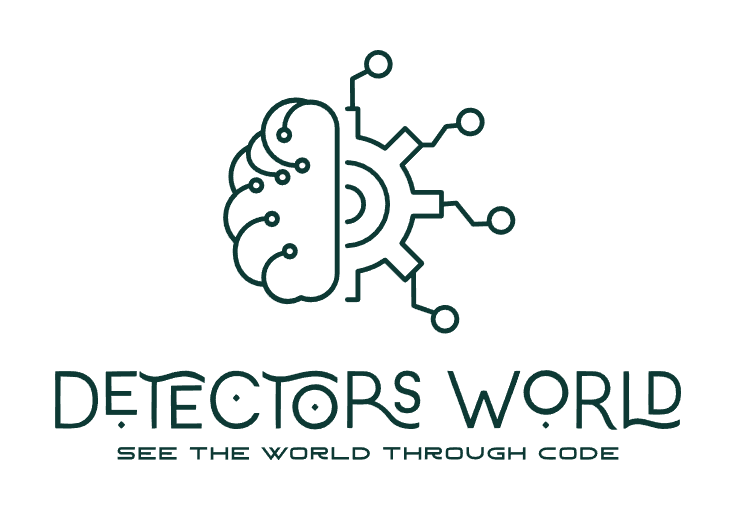
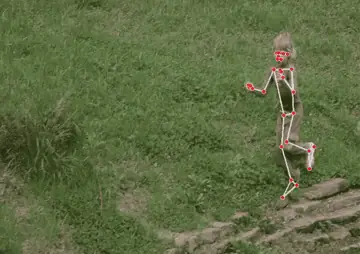
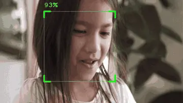
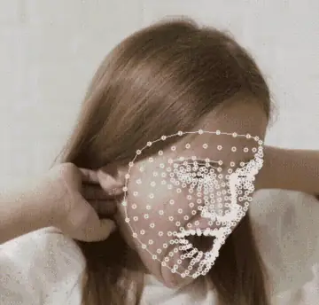

# Detectors World { .dw-title }

<div class="dw-hero" markdown>



**Hand, pose and face detection in a few lines of Python.**
Detectors World gives you ready-made computer vision detectors that work directly with OpenCV images.

[Get started](getting-started/quickstart.md){ .md-button .md-button--primary }
[Browse examples](examples/index.md){ .md-button }

</div>

```bash
pip install detectors-world
```

```python
import cv2 as cv
from detectors_world import create_detector

cap = cv.VideoCapture(0)

with create_detector("hand") as hand:
    while True:
        ok, frame = cap.read()
        if not ok:
            break
        hands = hand.detect(frame)  # draws on frame and returns what it found
        cv.imshow("Hand Detection", frame)
        if cv.waitKey(1) & 0xFF == ord("q"):  # press q to quit
            break

cap.release()
cv.destroyAllWindows()
```

## Detectors

<div class="grid cards" markdown>

-   :material-hand-back-right:{ .lg } **[Hand](detectors/hand.md)**

    ---

    { .dw-demo loading=lazy width=380 height=254 }

    Finds hands, 21 landmarks each, and tells left from right.

-   :material-human-handsup:{ .lg } **[Pose](detectors/pose.md)**

    ---

    { .dw-demo loading=lazy width=360 height=254 }

    Finds bodies and 33 landmarks from head to toe.

-   :material-face-recognition:{ .lg } **[Face](detectors/face.md)**

    ---

    { .dw-demo loading=lazy width=360 height=204 }

    Finds face boxes, confidence scores and 6 key points.

-   :material-face-man-outline:{ .lg } **[Face Mesh](detectors/face-mesh.md)**

    ---

    { .dw-demo loading=lazy width=360 height=344 }

    Finds 478 landmarks covering the face, lips, eyes and irises.

</div>

## Why Detectors World

<div class="grid cards" markdown>

-   :material-lightning-bolt:{ .lg } **Short code**

    One call creates a detector, and one call runs it. Models download by themselves the first time.

-   :material-image-outline:{ .lg } **Made for OpenCV**

    Pass the frame you already have. Drawing happens on it directly, so `cv.imshow` shows the result.

-   :material-format-list-numbered:{ .lg } **Simple results**

    Get pixel positions you can compare, measure and draw with, no conversion needed.

-   :material-book-open-variant:{ .lg } **Complete reference**

    Every landmark is mapped and named in the [landmark maps](reference/landmarks.md).

</div>
